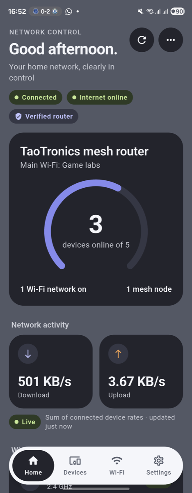
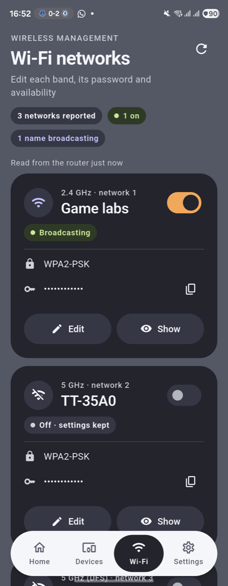
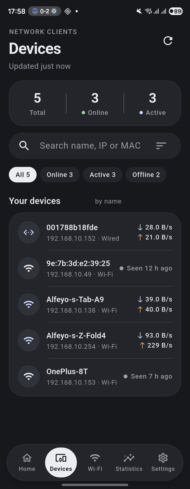
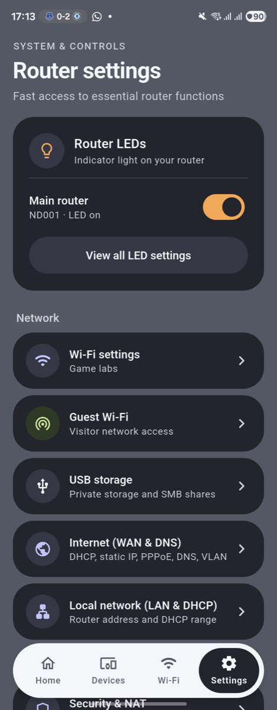

# TaoTronics AC3000 Wi-Fi Router App

A Flutter-based local control app for TaoTronics AC3000 Mesh Wi-Fi Routers.

[](https://github.com/alfeyo/Taotronics-AC3000-Wi-Fi-App/raw/main/releases/TaoTronics-Router-App.apk)

## About

This app provides local network control for TaoTronics AC3000 mesh routers without requiring cloud connectivity or the original vendor app (which is no longer supported/available).

### Features

- **Router discovery**: finds TaoTronics mesh routers on the local network and reconnects automatically
- **Verified local control**: MQTT over TLS; the router's certificate is cryptographically checked against the TaoTronics CA
- **Network overview**: internet status, live throughput (router WAN rate or connected-device sum, always labelled), devices, mesh nodes, router uptime, USB storage
- **Devices**: search, filters (online / active / offline), sorting and per-device details reported by the router
- **Wi-Fi**: every network the router reports gets its own card with an on/off switch, name/password editor and masked password; saves keep all other router fields and are confirmed by reading the router back after it reconnects
- **Router LEDs**: main-router LED switch on Home and Settings, per-node LED control
- **Settings**: guest Wi-Fi, WAN/DNS, LAN/DHCP, firewall, UPnP/DMZ, Fast NAT, QoS, VPN client, port forwarding, DDNS, LEDs, restart schedule, USB storage
- **Setup**: Bluetooth provisioning of new or reset routers, and local pairing
- **Diagnostics**: measured gateway latency and router response time, plain-language findings, exportable report (passwords excluded)
- **Smart-home design**: charcoal and slate with indigo and amber accents, floating navigation, light and dark mode, folded and unfolded layouts (Galaxy Z Fold), large text

| Home | Wi-Fi | Devices | Settings |
| --- | --- | --- | --- |
|  |  |  |  |

## Legal Disclaimer

**THIS SOFTWARE IS PROVIDED FOR PERSONAL, NON-COMMERCIAL USE ONLY.**

This project is:
- **NOT affiliated with, endorsed by, or connected to TaoTronics, RAVPower, or any related companies**
- **NOT intended for sale or commercial distribution**
- **Provided as-is, without warranty of any kind**

### Purpose

This app was created because:
1. The original TaoTronics/TT Router app has been discontinued and removed from app stores
2. Router owners deserve continued access to manage their own hardware
3. Local network control should not depend on cloud services that may be discontinued

### Fair Use

This project is provided to help owners of TaoTronics AC3000 routers maintain control over their own devices. The router hardware belongs to the user, and this app simply provides an interface to manage it locally.

**By using this software, you acknowledge that:**
- You own or have authorized access to the router you are controlling
- You will not use this software for any illegal purposes
- You will not redistribute this software for commercial gain
- The developers are not responsible for any issues arising from use of this software

## Download

**[Download APK](https://github.com/alfeyo/Taotronics-AC3000-Wi-Fi-App/raw/main/releases/TaoTronics-Router-App.apk)** - TT Router 1.2.1 (build 4), package `com.ttrouter.tt_router_flutter`

SHA-256: `417ee3b98bb05716f6c487c5451cf0f7cc48dced4294ac95cf87b132edae49b8`

Previous releases are available from the `v1.2.0` and `v1.1.0` git tags.

This is a sideload build signed with a development (debug) key, not a store
release. Installing it over an earlier sideloaded TT Router build keeps your
saved router pairing.

> Note: before 1.1.0 this download path contained the vendor's original app
> (`com.taotronics.router` 1.0.0.33), not this project. That file is still
> available in the git history at commit `f2d27a3`.

To install:
1. Download the APK file
2. Enable "Install from unknown sources" in your Android settings
3. Open the APK file to install

## Requirements

- Android device (Android 7.0+)
- TaoTronics AC3000 Mesh Router on your local network
- Device must be connected to the router's Wi-Fi network

## Building

```bash
# Install Flutter SDK
# Clone this repository
git clone https://github.com/alfeyo/Taotronics-AC3000-Wi-Fi-App.git
cd Taotronics-AC3000-Wi-Fi-App

# Get dependencies
flutter pub get

# Static checks and tests
flutter analyze
flutter test
(cd android && ./gradlew :app:testDebugUnitTest)

# Release APK for phones
flutter build apk --release --target-platform android-arm,android-arm64

# Install on a connected device (main Android user)
adb install -r --user 0 build/app/outputs/flutter-apk/app-release.apk
```

Release signing: without `android/key.properties` the release build uses the
debug key (sideload only). To sign with your own key, create
`android/key.properties` with `storeFile`, `storePassword`, `keyAlias` and
`keyPassword`. Note that a build signed with a different key cannot be
installed over an existing debug-signed install without uninstalling it
(which removes saved pairings).

See `docs/OVERHAUL_LOG.md` for the change and verification history and
`docs/FEATURE_INVENTORY.md` for where every control lives.

## Usage

1. Connect your phone to your TaoTronics router's Wi-Fi network
2. Open the app
3. The app will automatically discover your router
4. Tap "Continue to Dashboard" to access router controls

## Contact

For questions, issues, or contributions:
- **Email**: alfeyokatebe@gmail.com
- **GitHub Issues**: https://github.com/alfeyo/Taotronics-AC3000-Wi-Fi-App/issues

## License

This project is for personal use only. See the Legal Disclaimer section above.

---

*This project is not affiliated with TaoTronics, RAVPower, Sunvalley Group, or any of their subsidiaries.*
